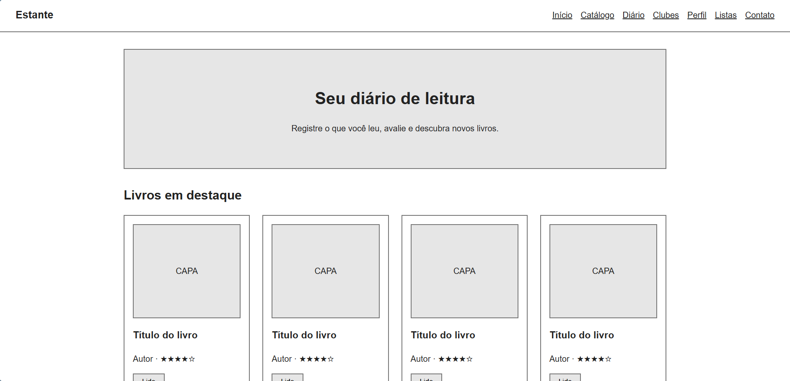
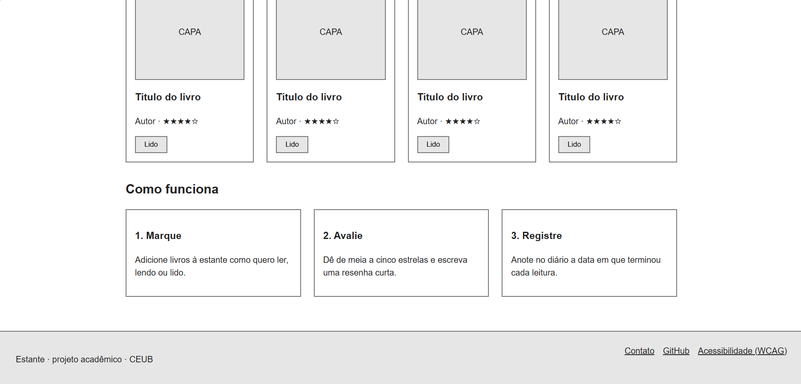
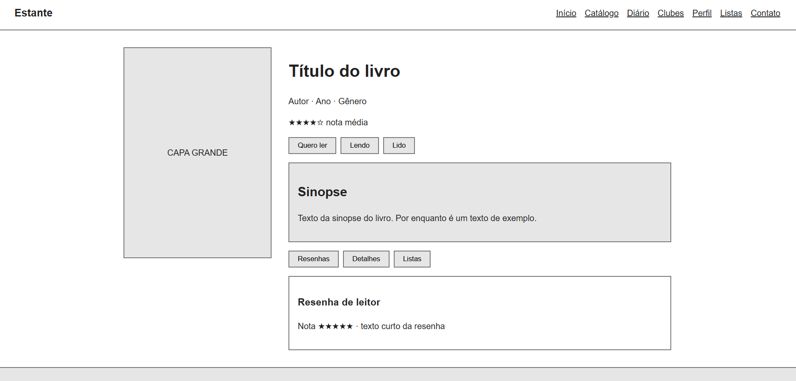

# Estante · Diário de leitura

Site acadêmico inspirado no Letterboxd, mas para livros. Projeto da disciplina
Desenvolvimento de Interfaces (CEUB, 2/2026).

## Versões

| Versão | Status          | Conteúdo                                                   |
| ------ | --------------- | ---------------------------------------------------------- |
| v1.0   | Concluída       | Estrutura em HTML, CSS básico, cartões, rodapé             |
| v2.0   | Em planejamento | Carrossel, abas de pesquisa, formulário, modo claro/escuro |
| v3.0   | Em planejamento | Login, aba de acessibilidade, WCAG e contraste             |

## v1.0: Estrutura

### O que foi feito

1. Criação da pasta `estante` no repositório, com `css/`, `js/` e `img/`.
2. Página inicial (`index.html`) com cabeçalho, 4 cartões de livros,
   3 cartões explicativos e rodapé.
3. Página do livro (`livro.html`) com capa, sinopse e resenha.
4. Página de contato (`contato.html`) com formulário e cartões laterais.
5. CSS básico em `css/style.css`, em tons de cinza, com layout em grid e flexbox.

### Decisões

- Usei tags semânticas (`header`, `nav`, `main`, `section`, `article`, `footer`)
  para ajudar leitores de tela.
- Cada campo do formulário tem um `label` ligado ao `id`.
- A v1 é só o esqueleto; as cores definitivas entram em versão posterior.

### Como executar

Abra a pasta `estante` no VS Code e use a extensão Live Server no `index.html`.

## Capturas de tela - versão v1.0

### Página inicial

### Página do livro

### Página de contato

