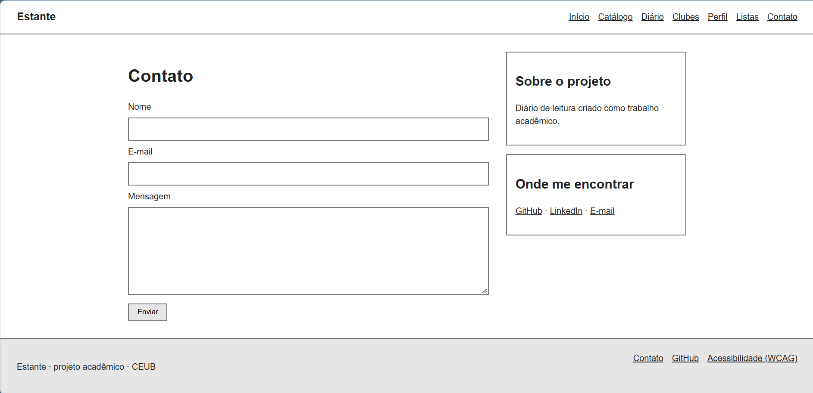
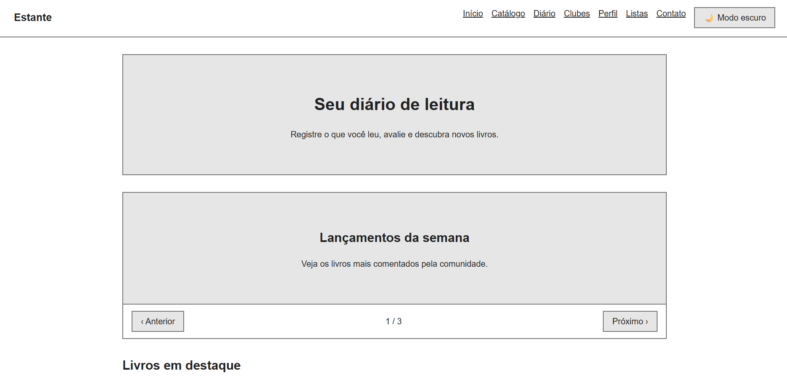
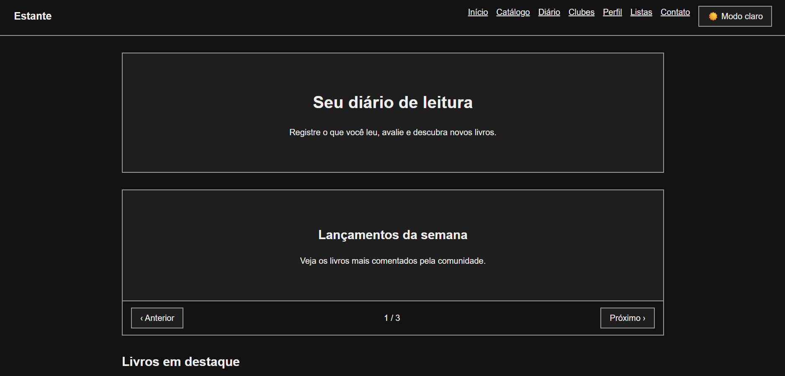
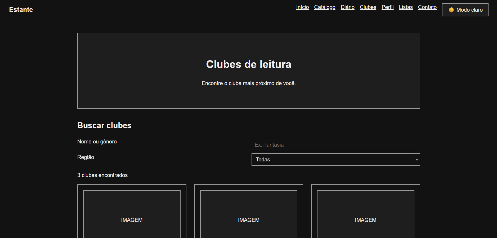
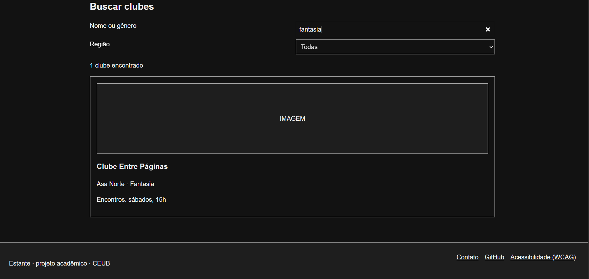
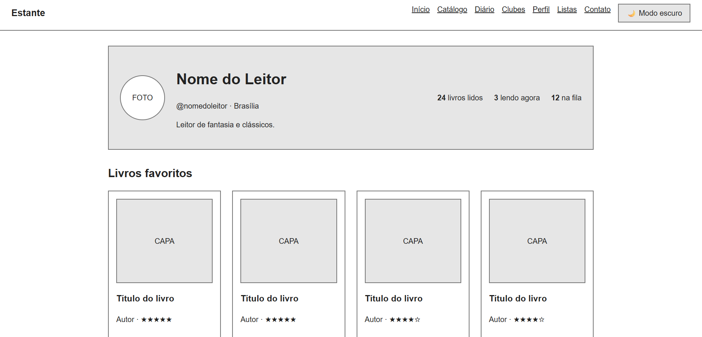
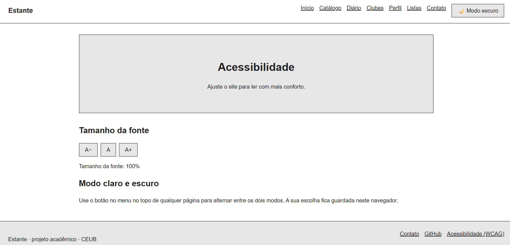
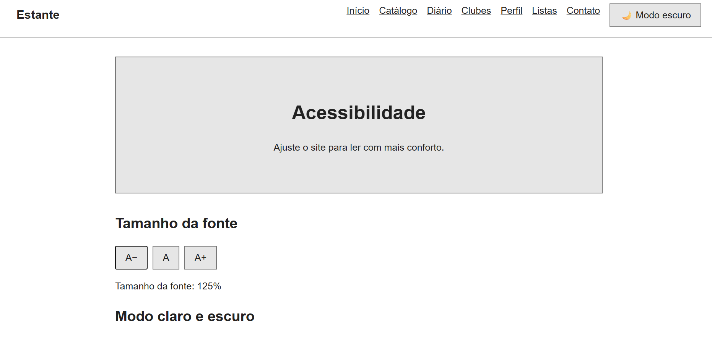
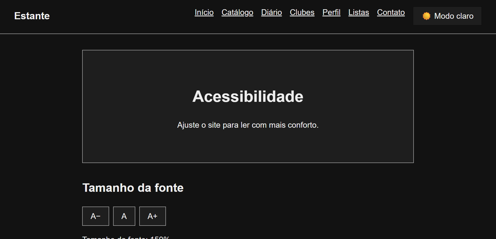

# Estante · Diário de leitura

Site acadêmico inspirado no Letterboxd, mas para livros. Projeto da disciplina
Desenvolvimento de Interfaces (CEUB, 2/2026).

## Versões

| Versão | Status          | Conteúdo                                                   |
| ------ | --------------- | ---------------------------------------------------------- |
| v1.0   | Concluída       | Estrutura em HTML, CSS básico, cartões, rodapé             |
| v2.0   | Em planejamento | Carrossel, abas de pesquisa, formulário, modo claro/escuro |
| v3.0   | Em planejamento | Login, aba de acessibilidade, WCAG e contraste             |

## v1.0: Estrutura

### O que foi feito

1. Criação da pasta `estante` no repositório, com `css/`, `js/` e `img/`.
2. Página inicial (`index.html`) com cabeçalho, 4 cartões de livros,
   3 cartões explicativos e rodapé.
3. Página do livro (`livro.html`) com capa, sinopse e resenha.
4. Página de contato (`contato.html`) com formulário e cartões laterais.
5. CSS básico em `css/style.css`, em tons de cinza, com layout em grid e flexbox.

### Decisões

- Usei tags semânticas (`header`, `nav`, `main`, `section`, `article`, `footer`)
  para ajudar leitores de tela.
- Cada campo do formulário tem um `label` ligado ao `id`.
- A v1 é só o esqueleto; as cores definitivas entram em versão posterior.

### Como executar

Abra a pasta `estante` no VS Code e use a extensão Live Server no `index.html`.

## Capturas de tela - versão v1.0

### Página inicial

### Página do livro

### Página de contato

## ## v2.0: Estrutura

Segunda versão do Estante. Na v1 existiam as páginas Início, Livro e Contato; na v2 o site ganha novas páginas e recursos de acessibilidade.

### O que mudou da v1 para a v2

- **Modo claro/escuro:** as cores viraram variáveis CSS e o botão no menu alterna o tema. A escolha fica salva no navegador.
- **Carrossel no Início:** três destaques, com botões Anterior/Próximo e contador. Não troca sozinho, e dá para usar pelo teclado.
- **Página Clubes:** campo de busca e filtro por região, com contagem dos resultados atualizada na hora.
- **Página Perfil:** topo com foto e estatísticas, livros favoritos e histórico de avaliações.
- **Página Acessibilidade:** controle do tamanho da fonte (A−, A, A+), que vale para todas as páginas e fica salvo.

### Prints

### Acessibilidade (WCAG)

- Carrossel sem troca automática, evitando movimento que o usuário não controla (critério 2.2.2, pausar, parar ou ocultar).
- Todos os controles funcionam pelo teclado.
- Campos de busca com `label` associado.
- Contagem de resultados da busca anunciada com `role="status"`.
- Tema e tamanho da fonte persistem entre as páginas.
- Contraste entre texto e fundo: _(preencher com os valores que você medir no WebAIM Contrast Checker, nos dois temas)_

### Arquivos novos na v2

- `clubes.html`, `perfil.html`, `acessibilidade.html`
- `js/tema.js`, `js/carrossel.js`, `js/clubes.js`, `js/fonte.js`

### Ferramentas

VS Code, Git e GitHub. Claude (IA) foi usado como apoio na escrita do código (CSS e JavaScript).
